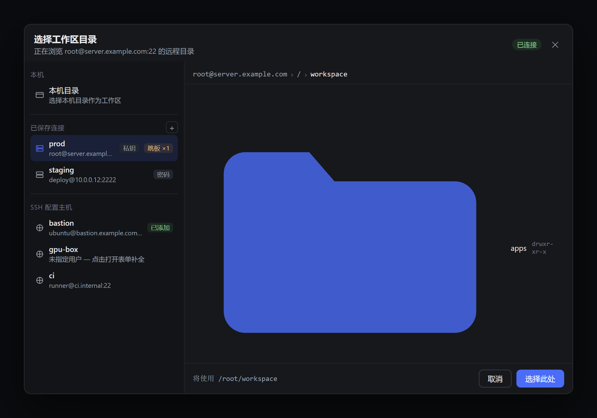

# dsh-ssh

[English](README.md) | 中文

<p align="center">
  
  
  
  
</p>

**[DeepSeek Harness](https://github.com/deepseek-ai/deepseek-harness) 的 SSH 远程开发插件**。用一条 SSH 连接把 Bash / 文件工具 / PTY 终端 / LSP 整体切到远程主机——支持跳板链（ProxyJump）、SFTP、完整认证。基于 [ssh2](https://github.com/mscdex/ssh2)。



## 安装

```sh
dsh plugin --profile web add dsh-ssh
```

或在 Web 界面：**插件 → 添加插件 → `dsh-ssh`**。bundle 会挂载 SSH provider 并接管「**添加工作区**」流程——真实连接在那里创建。需要 DeepSeek Harness 0.2.x 与 Node ≥ 22。

普通 `npm i dsh-ssh` 不会选中 bundle；需自己加进 `dsh.profile.bundles`。

## 配置

只有手动组合 provider（`cordis.yml`）时才需要：

```yaml
- id: ssh-remote
  name: dsh-ssh
  config:
    host: server.example.com        # 也可用 ~/.ssh/config 别名
    username: root
    privateKey: ~/.ssh/id_ed25519   # 私钥路径或 PEM 内容
    cwd: /root/workspace
    # jump:
    #   - { host: bastion.example.com, privateKey: ~/.ssh/id_ed25519 }
```

| 字段 | 默认 | 说明 |
|---|---|---|
| `host` `username` `cwd` | — | 必填（`cwd` 为绝对 POSIX 路径） |
| `port` | 22 | |
| `password` `privateKey` `passphrase` `agent` | — | 任意认证方式；未配置时回退 `~/.ssh` 默认私钥 |
| `jump` | `[]` | 跳板链，每级独立认证 |
| `readyTimeout` `keepaliveInterval` `keepaliveCountMax` | 45000 / 0 / 3 | 毫秒 |
| `strictHostKeyChecking` `knownHosts` | false / `[]` | 主机指纹校验 |

> **Web profile：** `subprocess` 与 `fs` 是单槽位服务。请在 profile 补丁里禁用本机 provider（`dsh-subprocess-local`、`dsh-fs-sandbox`），否则远程操作会悄悄落在 harness 宿主机上。

## 已知限制

- 远端 pid 恒为 `-1`；`terminate` 不保证回收子进程（SSH 协议所限）。
- SSH 连接断开后不会自动重连——需重建连接。
- `streamText` 仅文本；远程会话不会写入本地 workspace 注册表。

## 开发

```sh
npm i
npm run typecheck
npm run build   # 产出 lib/ —— harness 加载器实际导入的产物
```

## License

MIT
